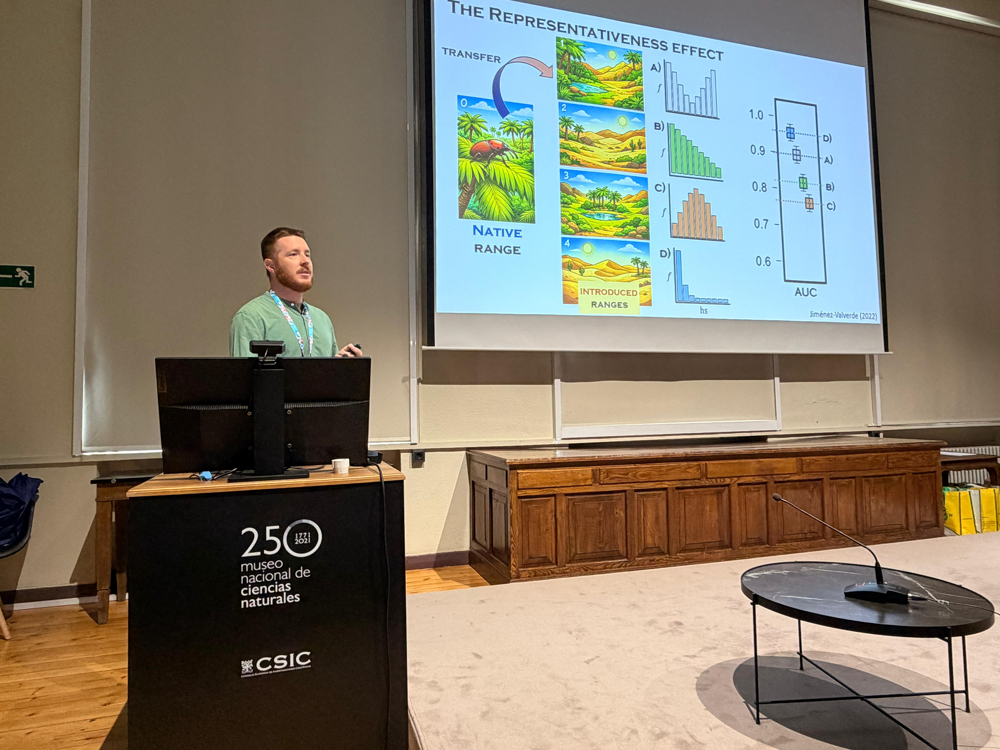
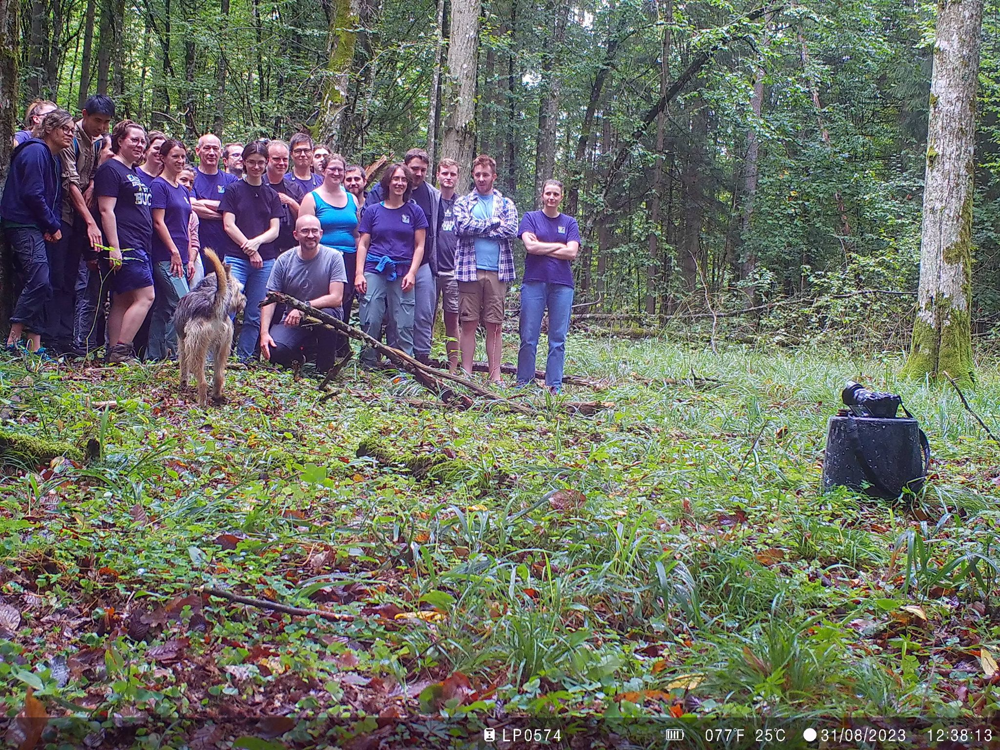
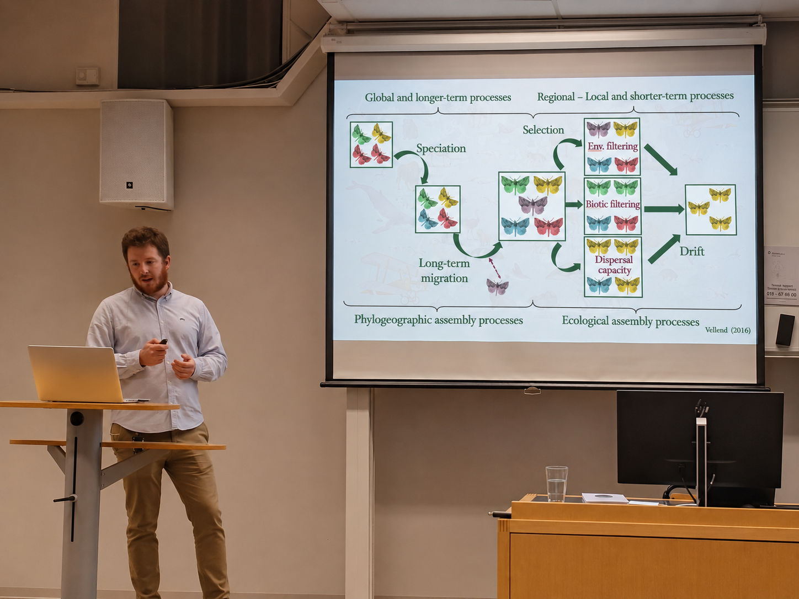
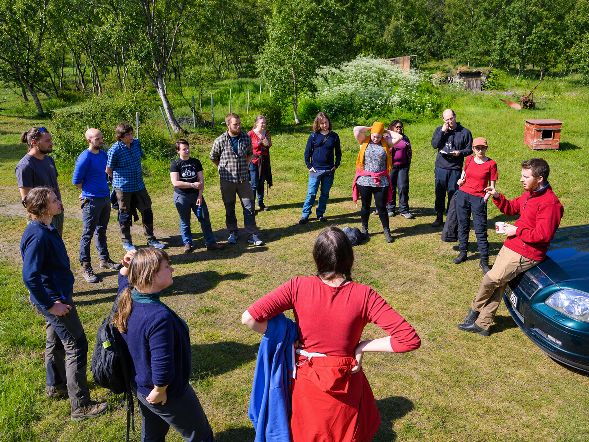
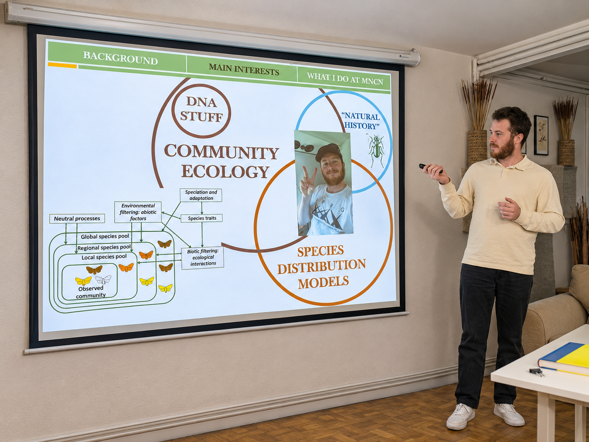
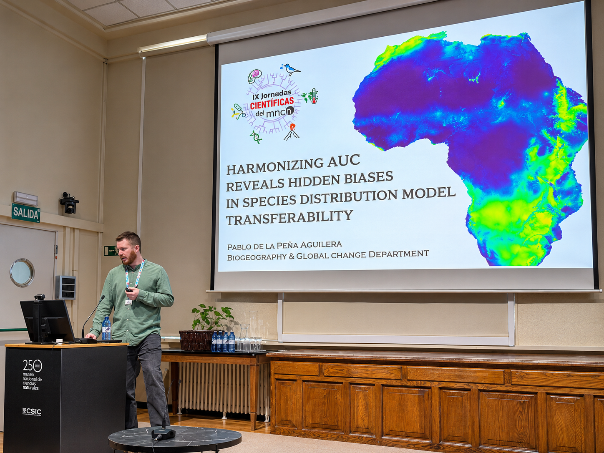

<!--
PAGE LAYOUT GUIDE
- Conferences and Media coverage: full-width text, no columns.
- Science dissemination and Organising committees: full-width text, followed by
  a horizontally scrollable photo gallery with a visible scrollbar.
- Research leadership and student mentoring: text left, photograph right.

TO ADD A PHOTO TO A CAROUSEL
Copy an image into the images/ folder, then duplicate a <figure> block
block inside the relevant .outreach-carousel-track below and change its filename
and alt text. Swipe, scroll or drag the horizontal scrollbar to browse.
The gallery appearance is controlled by section 10 of style.css.
-->

## International Conferences and workshops

:::: {.timeline}
::: {.timeline-entry}
**2026 · IX Jornadas Científicas del Museo Nacional de Ciencias Naturales** — 18th–19th March, Madrid, Spain · **Oral presentation**  
Peña-Aguilera, P. & Jiménez-Valverde, A. *Harmonizing AUC reveals hidden biases in species distribution model transferability*
:::
::: {.timeline-entry}
**2026 · International Biogeography Society, 12th Biennial Conference** — 6th–10th January, Aarhus, Denmark · **Oral presentation**  
Adam B. Smith et al. *Variation across species distribution models of the same species modelled by independent teams: Are we converging as a field?*
:::
::: {.timeline-entry}
**2025 · Departmental Annual Symposium – Biogeography and Global Change** — 2nd October, El Ventorrillo, Spain · **Oral presentation**  
Peña-Aguilera, P. *Career path in Ecology and current research path*
:::
::: {.timeline-entry}
**2024 · Spatial Foodweb Ecology Workshop** — 16th–19th April, Tarfala, Sweden · **Oral presentation**  
Peña-Aguilera, P. *Life at the Edge: Determinants of Insect, Plant, and Microbial Diversity in Subarctic Ecosystems*
:::
::: {.timeline-entry}
**2023 · Spatial Foodweb Ecology Workshop** — 30th August – 1st September, Białowieża, Poland · **Oral presentation**  
Peña-Aguilera, P., Schmidt, N. M., van der Wal, R., Maclean, I. M. D. & Roslin, T. *Consistent imprints of microclimate on subarctic insect diversity*
:::
::: {.timeline-entry}
**2022 · Microclimate Ecology & Biogeography Conference** — 30th August – 2nd September, Antwerp, Belgium · **Poster**  
Peña-Aguilera, P. & Roslin, T. *Microclimatic variation shapes plant and insect diversity across subarctic landscapes*
:::
::: {.timeline-entry}
**2021 · Spatial Foodweb Ecology Workshop** — 23th–25th November, Bågaskär, Finland · **Oral presentation**  
Peña-Aguilera, P., Parisy, B., Stewart, L., Vesterinen, E., Wirta, H. & Roslin, T. *Stable Through Space: Why Insect Beta Diversity Refuses to Scale*
:::
::: {.timeline-entry}
**2019 · XVIII Iberian Congress of Entomology** — 10th–13th July, Madrid, Spain · **Oral presentation**  
Peña-Aguilera, P. & Jiménez-Valverde, A. *Predicting the distribution of Argiope trifasciata with Bioclim and GAM: which gives more with less?*
:::
::: {.timeline-entry}
**2019 · XVIII Iberian Congress of Entomology** — 10th–13th July, Madrid, Spain · **Poster**  
Rodríguez-Rey, M., Peña-Aguilera, P. & Jiménez-Valverde, A. *Climatic variables in species distribution models: WorldClim or Iberian Climate Atlas?*
:::
::::

## Science dissemination

- **2025 · European Researchers' Night, XVI edition** — *La gran gymkhana científica*, MNCN-CSIC, Madrid, Spain · 26th September.
- **2023 · Spatial Foodweb Ecology Workshop** — *The use of AI in science: Pros and Caveats*, Białowieża, Poland · 1st September.
- **2021 · Austertana, Norway** — *How to sample more with less? Current methods for insect sampling* · 10th August.

<!-- Six user-supplied outreach photographs are shown below. -->

<figure class="outreach-carousel-slide">

</figure>
<figure class="outreach-carousel-slide">

</figure>
<figure class="outreach-carousel-slide">

</figure>
<figure class="outreach-carousel-slide">

</figure>
<figure class="outreach-carousel-slide">

</figure>
<figure class="outreach-carousel-slide">

</figure>

## Media coverage

- **2020 · Spain** — *Las fotos subidas a Flickr ayudan a predecir los movimientos de las especies animales en escenarios de cambio climático.* [Media article](https://tinyurl.com/r9xfdyd) · 20th March.

- **2024 · Sweden** — *Subarctic species richness and distribution influenced by climate.* [Media article](https://www.slu.se/en/news/2024/06/subarctic-species-richness-and-distribution-influenced-by-climate/) · 12th June.

## Organising committees

- **2026 · IX Jornadas Científicas del Museo Nacional de Ciencias Naturales**, Madrid, Spain · 18th–19th March.

- **2025 · Departmental Annual Symposium – Biogeography and Global Change**, El Ventorrillo, Spain · 2nd October.

- **2020 · Ecology Departmental Symposium**, Uppsala, Sweden · 4th–5th November.

<!-- Four user-supplied organising-committee photographs are shown below. -->

<figure class="outreach-carousel-slide">

</figure>
<figure class="outreach-carousel-slide">

</figure>
<figure class="outreach-carousel-slide">

</figure>
<figure class="outreach-carousel-slide">

</figure>

## Research leadership and student mentoring

:::: {.outreach-feature}

::: {.outreach-copy}

I have **twice coordinated international research teams across Fennoscandia and Greenland**, helping organise collaborative fieldwork and biodiversity sampling in remote environments.

I have also contributed to student supervision, including **co-supervision of a bachelor's thesis** and **co-supervision of a master's student**.

:::

::: {.outreach-gallery}

<!-- Photo to the right of the leadership and mentoring text. -->

:::

::::
