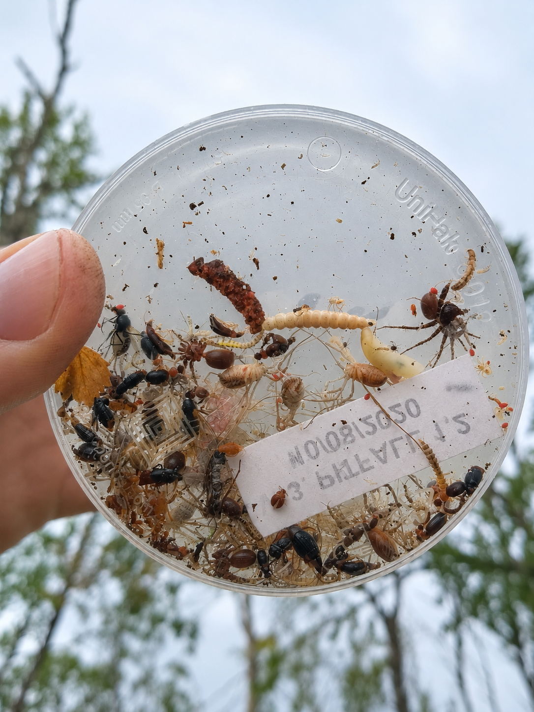
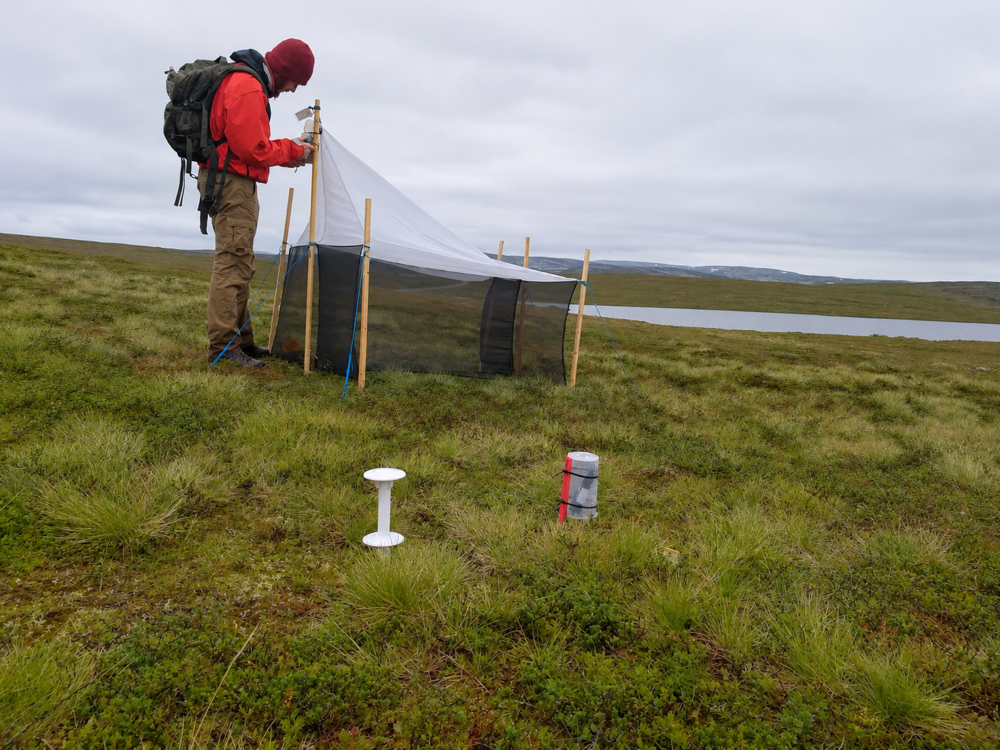
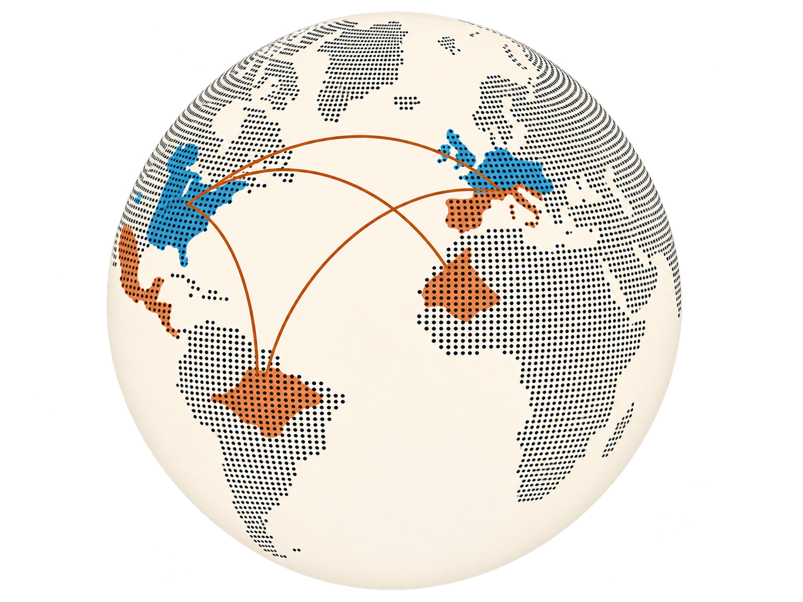
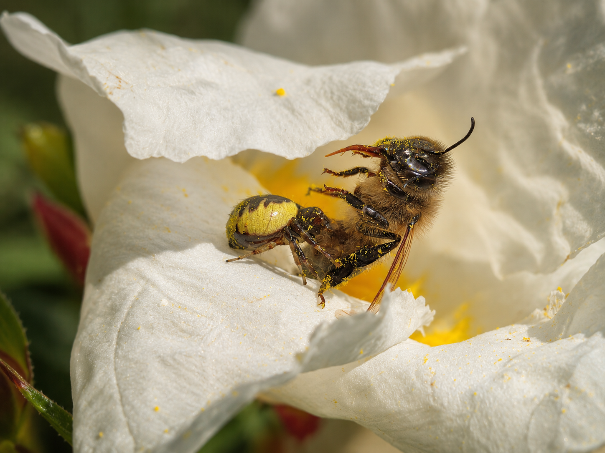
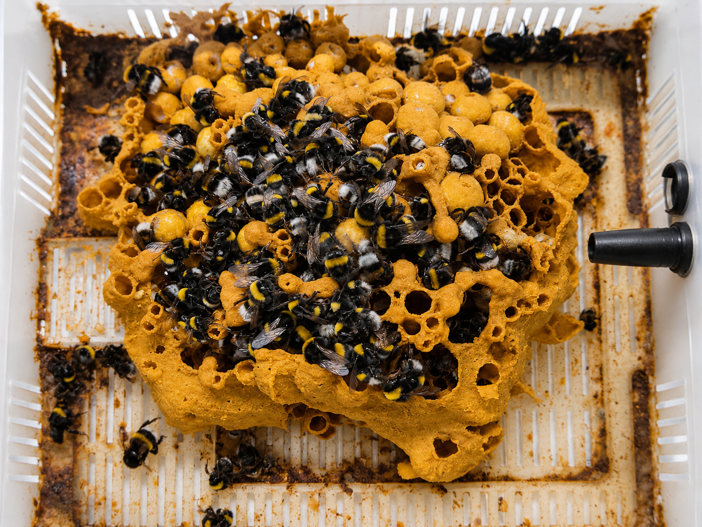
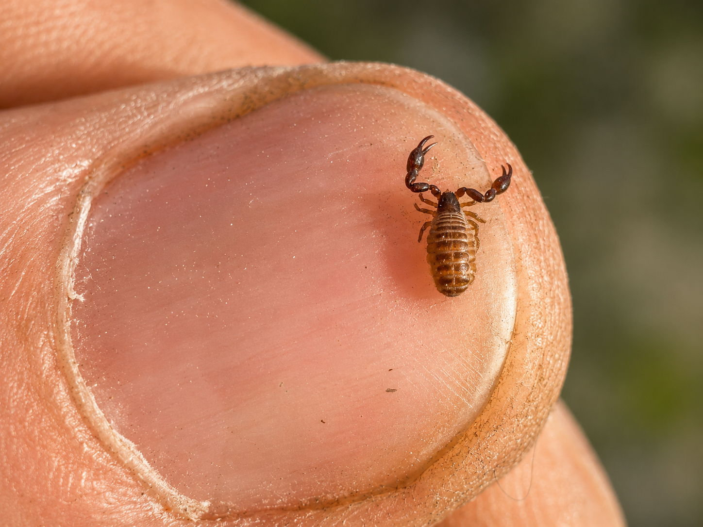

<!-- Homepage banner: content here, appearance in style.css (section 05). -->
::: {.hero-section .portrait-hero}
::: {.hero-content}
::: {.hero-heading}
# Dr. Pablo de la Peña Aguilera

ECOLOGIST · BIOGEOGRAPHER · FIELD&nbsp;NATURALIST
:::

::: {.hero-description}
I am an ecologist interested in understanding how ecological communities form, how species are distributed, and how environmental conditions shape biodiversity across space and time. 

I combine fieldwork, quantitative methods, and molecular tools to investigate these questions.
:::

::: {.hero-actions}
[Explore my research](research.qmd){.btn .btn-primary} [Get in touch](contact.qmd){.btn .btn-outline-light}
:::
:::

::: {.hero-portrait}
{.hero-portrait-image}
:::
:::

<!-- Homepage content: headings span the full content width. Edit the photos below in this file. -->
::: {.page-container}
ABOUT MY RESEARCH

## Connecting biodiversity patterns across scales

::: {.intro-grid}
::: {.intro-copy}
My research revolves around a broad question: **why do species occur where they do, and what shapes the ecological communities they form?** I explore this question through community ecology, biogeography, species distribution modelling, and molecular ecology, combining different perspectives to better understand how biodiversity is distributed and how it responds to environmental change.

During my PhD at the Swedish University of Agricultural Sciences, I explored **how microclimate, environmental gradients, and ecological processes shape plant, arthropod, and microbial communities across subarctic landscapes**.

I later joined the National Museum of Natural Sciences (MNCN-CSIC), where my research focused on **the reliability and transferability of species distribution models**, particularly how well they predict species distributions beyond the regions in which they were developed.

I am currently working at the University of Alcalá, investigating **pathogens in wild bumblebees** and exploring **how environmental conditions and host characteristics influence their prevalence**.

Although these projects address different ecological questions, they share a common approach: combining **fieldwork, quantitative modelling, and molecular tools** to better understand biodiversity. Along the way, I try to keep natural history and the often-overlooked diversity of organisms within the scope of my research.
:::

::: {.intro-gallery}

<figure class="intro-photo-card">
  
</figure>

<figure class="intro-photo-card">
  
</figure>

<figure class="intro-photo-card">
  
</figure>

:::
:::

AREAS OF INTEREST

## Questions that connect my research

::: {.interest-grid}

::: {.interest-card}

  

  01
  <h3>What processes shape community assembly?</h3>
  
From environmental filtering and dispersal to species interactions.

:::

::: {.interest-card}

  

  02
  <h3>How can we better model and predict species distributions?</h3>
  
Understanding environmental niches, evaluating species distribution models, and improving predictions across geographic regions.

:::

::: {.interest-card}

  

  03
  <h3>Can we use molecular approaches to track interactions?</h3>
  
DNA-based approaches to identify species, uncover biodiversity and explore ecological interactions.

:::

::: {.interest-card}

  

  04
  <h3>What shapes pathogen prevalence in wild bees?</h3>
  
Disease ecology and environmental drivers of pathogen prevalence.

:::

::: {.interest-card}

  

  05
  <h3>What biodiversity are we still overlooking?</h3>
  
Exploring natural history, taxonomy, and the discovery and documentation of often-neglected species.

:::

:::

[Explore research themes and projects](research.qmd){.btn .btn-outline-primary}

## Education and Research Experience

A brief overview of my academic training and research appointments.

::: {.timeline}
::: {.timeline-entry}
**2026–2027 · Postdoctoral researcher** — University of Alcalá (UAH), Spain  
Pathogen prevalence in wild bumblebees using molecular ecology
:::
::: {.timeline-entry}
**2025–2026 · Postdoctoral researcher** — National Museum of Natural Sciences (MNCN-CSIC), Spain  
Species distribution modelling, evaluation and transferability.
:::
::: {.timeline-entry}
**2024 · Field assistant** — Zackenberg Research Station, Greenland  
Arctic insect-plant interactions, the influence of temperature gradients on insect activity and biodiversity research.
:::
::: {.timeline-entry}
**2019–2024 · PhD in Biology (Ecology)** — Swedish University of Agricultural Sciences (SLU), Uppsala, Sweden  
Community assembly and determinants of plant, arthropod, and microbial diversity across subarctic landscapes; Research stays at Exeter University and Helsinki University.
:::
::: {.timeline-entry}
**2017–2019 · Research assistant** — University of Alcalá (UAH), Spain  
EcoGeography research group.
:::
::: {.timeline-entry}
**2014–2016 · MSc in Applied Ecology** — Inland Norway University of Applied Sciences (INN), Evenstad, Norway
:::
::: {.timeline-entry}
**2009–2014 · BSc in Biology** — University of Alcalá (UAH), Spain
:::
:::
:::
