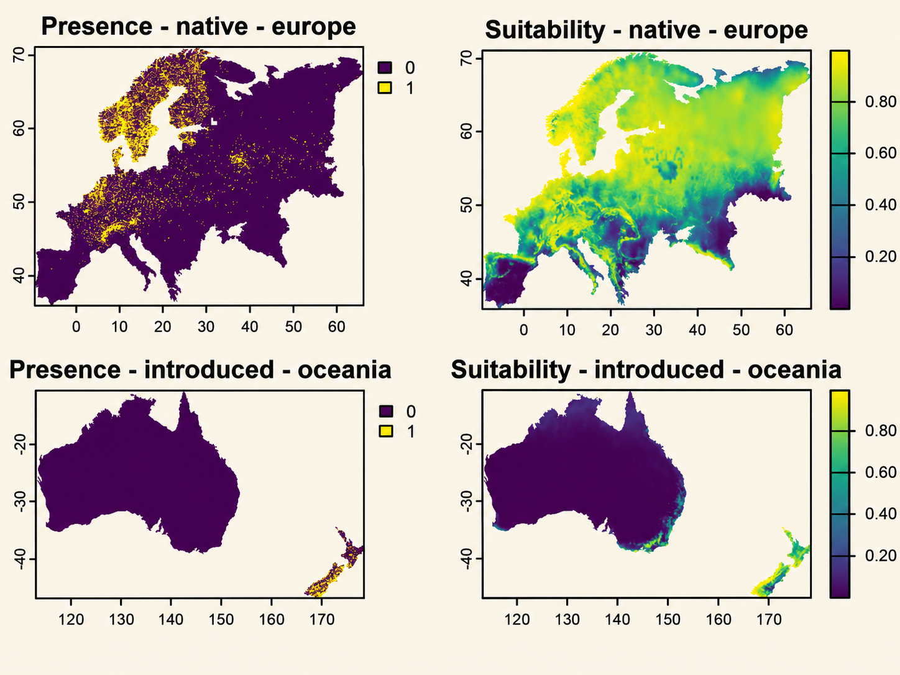

::: {.lead-copy}
Take a closer look at the **questions that drive my research** and **the projects through which I explore them!**
:::

## Community assembly and subarctic biodiversity

<!-- Image above; full-width text below. See style.css > RESEARCH. -->
::: {.research-section}
::: {.research-gallery .research-gallery-single .research-gallery-diagram}

:::

::: {.research-text}
**PhD research · Swedish University of Agricultural Sciences · 2019–2024**

Understanding how ecological communities form and change is central to my research. During my PhD, I explored the processes driving community assembly, particularly how environmental filtering, dispersal limitations, and resource availability influence species richness and composition. My work focused on plant, fungal, and arthropod communities across subarctic landscapes, examining how these processes interact to shape biodiversity across spatial and temporal scales.

**Selected work:** [Alpha diversity patterns are unmatched by beta diversity](https://doi.org/10.1002/ecs2.70581) ·
[Differential patterns in β-diversity across subarctic landscapes](https://doi.org/10.1111/geb.70325) ·
[Consistent imprints of elevation, soil temperature and moisture on plant and arthropod communities](https://doi.org/10.1111/icad.12667)

**Collaborative research · Phenology and species interactions**

Alongside my PhD, I contributed to collaborative projects exploring how seasonal dynamics and ecological interactions vary across space and time. These include research on long-term changes in Arctic spring phenology and studies investigating the spatial overlap and seasonal synchrony between insect hosts and their parasitoids. Together, these projects have broadened my interests in how environmental conditions influence the timing of ecological events and the interactions between species.

**Selected work:** [Little directional change in the timing of Arctic spring phenology over the past 25 years](https://www.cell.com/current-biology/fulltext/S0960-9822(23)00823-0) · [Spatial overlap and temporal synchrony between guilds of insect hosts and parasitoids](https://doi.org/10.1111/1365-2656.70228)
:::
:::

## Species distribution modelling and transferability

<!-- Image above; full-width text below. See style.css > RESEARCH. -->
::: {.research-section}
::: {.research-gallery .research-gallery-single .research-gallery-diagram}

:::

::: {.research-text}
**Postdoctoral research · MNCN-CSIC · 2025–2026**

Species distribution models help us understand the environmental conditions in which species occur and predict where they might be found. My research focuses on **how we evaluate the performance and reliability of these models**, particularly when they are used to predict species distributions beyond the regions where they were developed. Using **invasive species as case studies**, I explore how different evaluation metrics influence our interpretation of model performance when transferring predictions between native and introduced ranges.

**Selected work:** *Harmonizing AUC reveals hidden biases in species distribution model transferability* — manuscript under revision in Methods in Ecology and Evolution. · *Is species distribution modelling converging as a field? Consensus and divergence among teams in a blinded experiment.* — manuscript under revision in Global Change Biology.
:::
:::

## Molecular ecology and pathogen–pollinator interactions

<!-- Image above; full-width text below. See style.css > RESEARCH. -->
::: {.research-section}
::: {.research-gallery .research-gallery-three}
<figure class="research-photo">
  
</figure>

<figure class="research-photo">
  
</figure>

<figure class="research-photo molecular-closeup">
  
</figure>
:::

::: {.research-text}
**Postdoctoral research · University of Alcalá · 2026–2027**

I use molecular tools to investigate **pathogens in wild bumblebees across the Iberian Peninsula**, exploring how their prevalence relates to climatic conditions, landscape characteristics, and differences among hosts. 

**Research stay · University of Helsinki · 2021-2022**

More broadly, I am interested in how molecular approaches can help uncover **ecological interactions that might otherwise go unnoticed**. During my research stay at the University of Helsinki, I explored how DNA stored in honey can help reveal these often-hidden interactions and provide new insights into biodiversity patterns.

**Selected work:** [The role of seasonality in shaping honeybee interactions](https://doi.org/10.1002/ece3.10580) · [Latitudinal richness gradients in honeybee interaction partners](https://doi.org/10.1186/s12862-025-02363-1)
:::
:::

## Natural history, citizen science and dark taxa

<!-- Image above; full-width text below. See style.css > RESEARCH. -->
::: {.research-section}
::: {.research-gallery .research-gallery-three .natural-history-gallery}

<figure class="research-photo natural-history-featured">
  
</figure>

<figure class="research-photo">
  
</figure>

<figure class="research-photo">
  
</figure>

:::

::: {.research-text}
Natural history and entomology have been part of my scientific interests for many years. My work in this area includes **taxonomy, species discovery, and the study of poorly documented organisms (often referred to as dark taxa)**, alongside hands-on experience in **beetle identification (Coleoptera)**, particularly within the **family Carabidae**. I am also interested in how **citizen science** and online biodiversity platforms can **contribute to our understanding of species distributions** and help document overlooked biodiversity. These interests bring together my ecological research and my enthusiasm for collecting, identifying, and documenting the natural world.

**Selected work:** [Resolving biology’s dark matter](https://doi.org/10.1186/s12915-024-02010-z) · [A new *Leistus* species](https://www.researchgate.net/profile/Vicente-Ortuno/publication/352891761_A_case_of_allopatric_speciation_in_the_Central_System_Iberian_Peninsula_Leistus_elpis_sp_nov_a_sibling_species_of_Leistus_constrictus_Coleoptera_Carabidae/links/649ee3a2c41fb852dd4292aa/A-case-of-allopatric-speciation-in-the-Central-System-Iberian-Peninsula-Leistus-elpis-sp-nov-a-sibling-species-of-Leistus-constrictus-Coleoptera-Carabidae.pdf) · [Photo-sharing platforms and species distributions](https://doi.org/10.1111/icad.12351)
:::
:::

## International collaborations

Collaborating with researchers from different countries and scientific backgrounds has been an important part of my career. From fieldwork in remote landscapes to research stays and collaborative projects, these experiences have allowed me to **explore new approaches, develop different skills, and broaden my perspective on ecological research.**

::: {.timeline}
::: {.timeline-entry}
**2020 · University of Exeter, United Kingdom**  
Research stay with [**Prof. Ilya Maclean**](https://experts.exeter.ac.uk/3165-ilya-maclean), focused on microclimatic modelling and supported by a competitive research grant

**Related work:** [Microclimate research](https://doi.org/10.1111/geb.13834) 
:::
::: {.timeline-entry}
**2021–2022 · University of Helsinki, Finland**  
Research stay with [**Dr Helena Wirta**](https://www.umu.se/en/staff/helena-wirta/?flik=presentation), gaining hands-on experience in DNA metabarcoding, DNA extraction, qPCR, and sequencing library preparation. This collaboration also contributed to research on honeybee-associated ecological interactions.

**Related work:** [The role of seasonality in shaping honeybee interactions](https://doi.org/10.1002/ece3.10580) · [Latitudinal richness gradients in honeybee interaction partners](https://doi.org/10.1186/s12862-025-02363-1)

:::
:::

Beyond these research stays, I have been fortunate to collaborate with colleagues from different institutions and countries, sharing ideas, fieldwork, and research projects along the way.

<!-- Institution logos. Add a new logo by copying a logo-card below. -->
::: {.collaborator-logos}
::: {.collaborator-logo}

:::
::: {.collaborator-logo}

:::
::: {.collaborator-logo}

:::
::: {.collaborator-logo}

:::
::: {.collaborator-logo}

:::
::: {.collaborator-logo}

:::
::: {.collaborator-logo}

:::
::: {.collaborator-logo}

:::
:::
